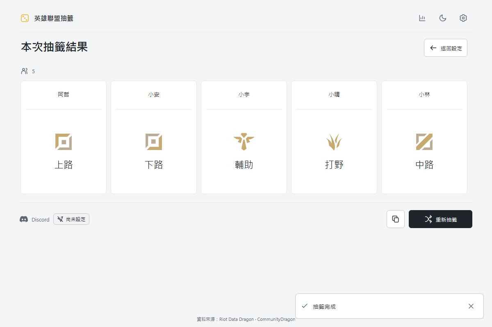

# 英雄聯盟抽籤工具

和朋友開一場 LoL，分路交給抽籤。

支援 1～5 人分路分配、主位偏好、英雄抽籤與 Discord 同步。可直接使用網站，也有能讀取 LoL 組隊大廳的 Windows App。

**[線上使用 →](https://lol-ramdom-tool.pages.dev/)** · [網站與 App](#網站與-app) · [使用說明](docs/guide.md) · [參與開發](#參與開發)



## 可以做什麼

- **抽分路**：最多 5 位玩家，主位不重複；少於 5 人時會分配副位。
- **保留偏好**：可以指定主位，或在 App 沿用客戶端第一偏好；指定重複時會提醒調整。
- **抽英雄**：從全英雄或指定分路的英雄池，隨機抽出一隻。
- **傳到 Discord**：設定自己的 Webhook，抽完自動同步分路結果。
- **留下紀錄**：查看歷史統計、快速加入歷史玩家，也能匯出／匯入統計備份。

## 網站與 App

| | 網站版 | Windows App |
| --- | --- | --- |
| 手動加入玩家、抽分路與抽英雄 | ✓ | ✓ |
| 統計、備份與 Discord 同步 | ✓ | ✓ |
| 讀取 LoL 組隊大廳名單 | — | ✓ |
| 選擇性套用自己的分路偏好 | — | ✓ |
| 使用方式 | 瀏覽器開啟即可 | Windows x64 安裝版／免安裝版 |

**Windows x64：[下載安裝版](https://github.com/morgan1020/lol-ramdom-tool/releases/download/v1.4.3/LOL-Random-Tool-1.4.3-Windows-Setup.exe)** · [免安裝版](https://github.com/morgan1020/lol-ramdom-tool/releases/download/v1.4.3/LOL-Random-Tool-1.4.3-Windows.exe) · [版本紀錄](https://github.com/morgan1020/lol-ramdom-tool/releases)

目前版本 **1.4.3**。

App 不需另裝 Node.js；目前未簽章，採手動更新。網站與 App 各自保存設定及紀錄，可透過統計備份搬移資料。

## 三步開始

1. 加入玩家：網站手動輸入；App 也能從 LoL 組隊大廳讀取。
2. 選擇隨機或指定主位，確認名單後進入抽籤。
3. 按「開始抽籤」，複製結果或同步到自己的 Discord 頻道。

想隨機決定要玩誰，切到「抽英雄」即可，不會改動分路統計。

進一步設定請看 [完整使用說明](docs/guide.md)，包含客戶端讀取、Discord Webhook、備份與更新方式。

## 參與開發

使用 React、Vite 與 Electron。請使用符合 Vite 需求的 Node.js（`^20.19.0 || >=22.12.0`）。

```bash
npm ci
npm run dev
```

```bash
npm run desktop                         # 啟動桌面版
npm run build                           # 建置網站
npm run desktop:build -- --publish never # 打包 Windows App
```

開發、資料更新、測試與部署細節見 [開發說明](docs/guide.md#開發)；協作規範見 [AGENTS.md](AGENTS.md)。問題與建議可透過 GitHub Issues 提出。

## 授權與致謝

程式碼及原創文件採用 [MIT License](LICENSE)。英雄資料與圖片來自 Riot Data Dragon，分路資料與圖示由 CommunityDragon 提供；遊戲素材與第三方套件保留各自條款，詳見 [第三方聲明](THIRD_PARTY_NOTICES.md)。

本專案非 Riot Games 官方產品，未獲 Riot Games 贊助或認可。LoL 客戶端介面可能隨遊戲更新而改變；App 的客戶端整合仍需持續驗證。

Riot Developer Portal 已建立產品 `898873`，網站驗證已通過，目前為 **Pending Review（等待審核）**，尚未獲 Riot 核准或確認 LCU 用途。詳見 [登記狀態](docs/riot-registration.md)。真實多人 LCU 與乾淨 Windows 安裝／升級情境尚未完整驗收。
