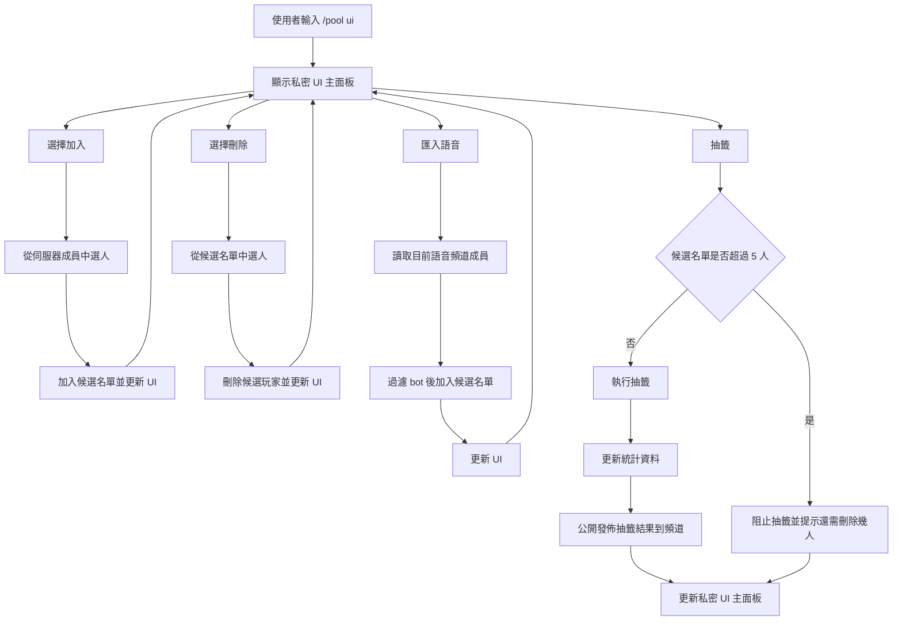

# Discord Bot Handoff Guide

## Overview
This bot provides League role drawing in Discord using slash commands, reusing the same core logic as the original web tool.

Key rules:
- Max 5 players per draw pool
- Unique main role assignment
- Secondary role for `<5` players, with unique main+secondary combinations
- Stats weighting: main `+1`, secondary `+0.5`

## Flow

## Core Commands
- `/pool ui` (ephemeral 互動面板：抽籤 / 選擇加入 / 選擇刪除 / 匯入語音；抽籤結果會公開發佈到頻道)
- `/pool list`
- `/pool clear` (manager only)
- `/stats [name]`
- `/resetstats` (manager only)

## Runtime Requirements
- Node.js `20+`
- `.env` with:
  - `DISCORD_TOKEN`
  - `CLIENT_ID`
  - `GUILD_ID`
  - `DB_PATH` (default `./data/bot.sqlite`)
- Discord Developer Portal:
  - `Server Members Intent` enabled

## Start / Update Flow
1. `npm install`
2. `npm run register`
3. `npm run start`
4. If slash commands look stale in client, press `Cmd+R` and re-run register.

## Important Files
- `src/index.js`: client setup and intents
- `src/commands/index.js`: slash command handlers
- `src/domain/draw.js`: draw algorithm
- `src/domain/poolMerge.js`: candidate merge logic for `from-voice`
- `src/repositories/*`: SQLite persistence
- `tests/*.test.js`: logic tests

## Validation Checklist
1. `npm test` passes.
2. `/pool ui` 的 `匯入語音` 在 requester 不在語音時會失敗。
3. `/pool ui` 的 `匯入語音` 只匯入真人（不含 bot）。
4. `/pool ui` 的 `抽籤` 在候選名單 > 5 人時會阻擋並提示需刪除人數。
5. `/pool ui` 的 `抽籤` 執行後 `/stats` 更新正確。
